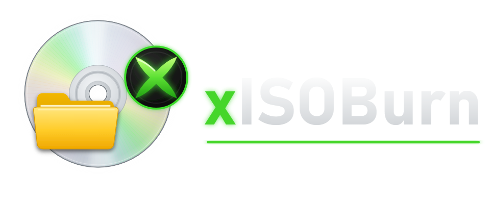
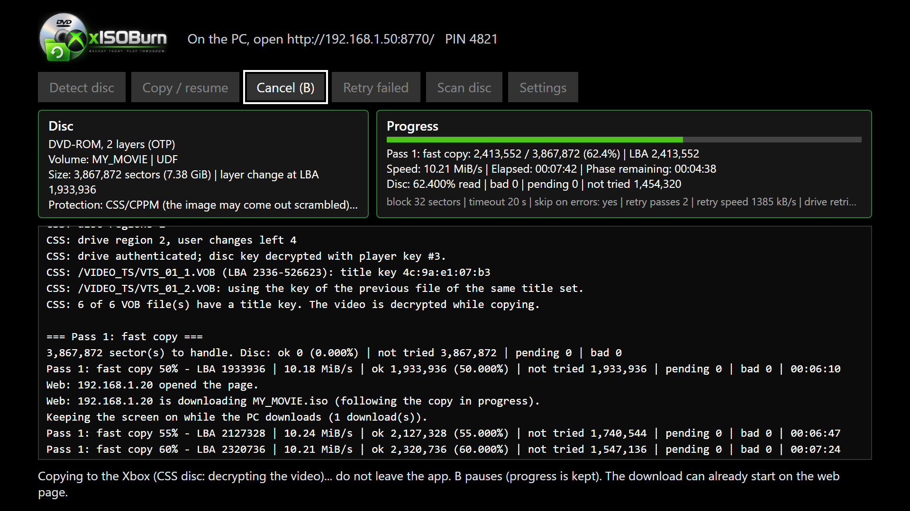
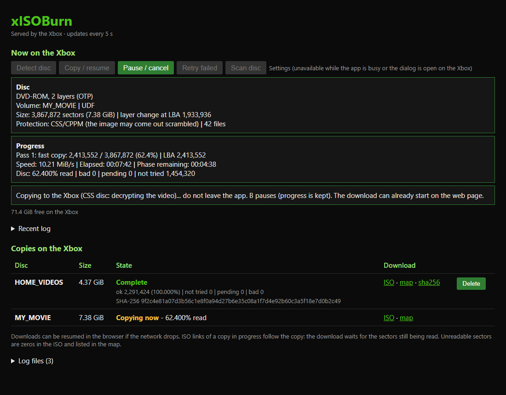
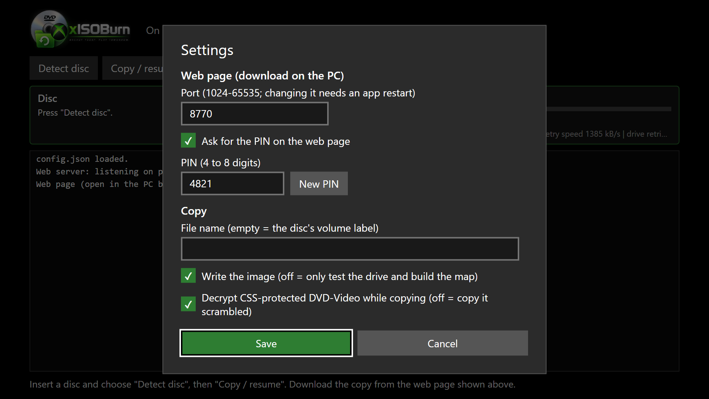
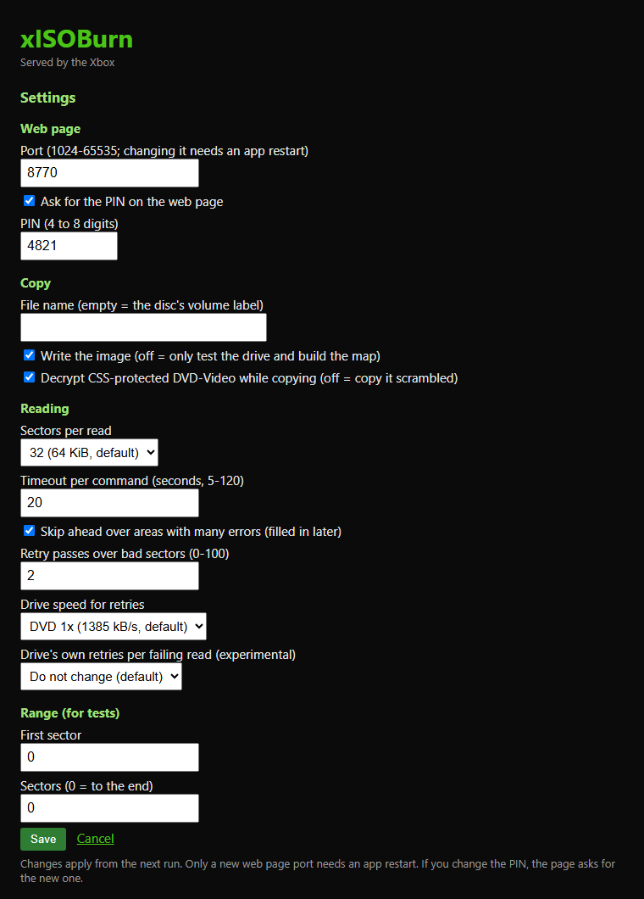

  

# xISOBurn

An Xbox Series X app (UWP, Developer Mode; the Series S has no disc drive) that copies the disc in the console's optical drive to an
ISO image, sector by sector. It serves a web page from which your PC's browser downloads the image.
You only install the Xbox app; the PC needs nothing.

- **Damaged discs:** the copy runs in multiple resumable passes, in the style of ddrescue. The
  readable data is copied first, then the damaged areas. A map records every sector, and the
  SHA-256 is computed when nothing is left to read. When the PC's DVD drive fails on a disc
  (`MEDIUM ERROR / UNRECOVERED READ ERROR`), the Xbox drive becomes a second reader.
- **CSS-protected DVD-Video:** the app authenticates with the drive and decrypts the video while
  copying, so the ISO plays in any player. The disc has to be from the console's region.
- **AACS / BD+ Blu-ray (experimental):** with key files you upload on the web page (**Blu-ray keys**:
  `KEYDB.cfg`, and for BD+ the libbdplus `vm0` player files or cached conversion tables), the app
  decrypts the `.m2ts` streams while copying and applies the BD+ fixups. The app ships no keys.
  AACS 2 (UHD) discs only work with a VUK or unit keys in `KEYDB.cfg`.
- **Download from the browser:** the copy reaches the PC over the local network. You can start the
  download while the copy is running, and resume it if the network drops. A PIN keeps others on the
  network out. The network is needed because files on USB storage are limited to about 2 GB in
  Developer Mode.
- **Gamepad or browser:** every action and setting is on the Xbox screen and also on the web page,
  so the copy can be started, paused and set up from the PC.

## How to use

### 1. Install

1. Download the latest version from the repository's **Releases** page. Every build of `master` is
   published there.
2. Put the console in Developer Mode and turn on the Device Portal.
3. In the PC browser, open the Device Portal and install the `.msix` with its dependencies.

Step by step: [docs/install.md](docs/install.md). Removing the app also deletes the copies stored on
the Xbox, so download them first.

### 2. Copy the disc on the Xbox

Open xISOBurn and insert the disc. Move between buttons with the D-pad and press **A** to choose.

| On the screen | What it is |
|---------------|------------|
| Top line | The address to open on the PC and the PIN |
| **Detect disc** | Reads the disc type, size, volume name and protection, and shows them in **Disc** |
| **Copy / resume** | Starts the copy, or continues a paused or unfinished one from where it stopped |
| **Cancel (B)** | Pauses the copy. Nothing is lost: **Copy / resume** continues later, even after the app was closed |
| **Retry failed** | Tries the sectors that could not be read once more. It is only enabled when there are some |
| **Scan disc** | A quick read-only health check that reads about 90 spots across the disc. It writes nothing |
| **Settings** | The settings below |
| **Progress** | The bar shows how much of the disc is copied. The text shows the current pass, speed and time left |
| Log | Everything the app does, line by line. Scroll it with the D-pad |
| Bottom line | What is happening now, or the result of the last action |

Usually you only need **Detect disc** and then **Copy / resume**. Keep the app open while it copies.
The screen stays on by itself.

**Damaged discs:** the copy first takes everything that reads easily, then goes back to the damaged
areas, slower and sector by sector. Sectors that still fail are listed in the log and in the `.map`
file. Try **Retry failed** later, or after cleaning the disc.

**CSS-protected DVD-Video:** nothing to do. The app decrypts the video while copying, so the ISO
plays in any player. The disc has to be from the console's region.

### 3. Download on the PC

On the PC, open the address shown at the top of the Xbox screen (for example `http://192.168.1.50:8770/`)
and type the PIN. The PC and the Xbox must be on the same network.

- **Now on the Xbox** has the same buttons as the app, and the same disc, progress and status
  information. You can run everything from the PC. Only inserting the disc needs you at the console.
  A button that is greyed out is also unavailable on the Xbox at that moment.
- **Recent log** opens the last lines of the log.
- **Copies on the Xbox** lists every copy:
  - **ISO** downloads the image. You can download while the copy is still running: the download
    waits for the sectors that are still being read. If the network drops, resume it in the browser.
  - **map** lists which sectors were read and which failed.
  - **sha256** is the hash of the finished image. Check your download with
    `Get-FileHash .\NAME.iso -Algorithm SHA256` in PowerShell and compare it with the page.
  - **Delete** removes the copy from the Xbox to free space. It isn't offered while that copy runs.
- **Log files** has the full log of each session.

The page updates itself every 5 seconds. While the Xbox handles a click, the page shows a loading
screen.

### 4. Settings

Open **Settings** on the Xbox, or **Settings** on the web page. Both have the same options and save to
the same file. Changes apply from the next copy.

| Xbox | Web page |
|------|----------|
|  |  |

| Setting | Default | What it does |
|---------|---------|--------------|
| Port | 8770 | Port of the web page. Changing it needs an app restart |
| Ask for the PIN | on | Turn it off only on a network you trust |
| PIN | random | 4 to 8 digits. **New PIN** makes another one |
| File name | empty | Name of the ISO. Empty uses the disc's volume name |
| Write the image | on | Off only tests the drive and builds the map, without saving the ISO |
| Decrypt CSS | on | Off copies DVD-Video as it is on the disc, still encrypted |
| Sectors per read | 32 | How much is read at once in the good areas |
| Timeout per command | 20 s | How long to wait for the drive on each read |
| Skip ahead over areas with many errors | on | Copies the easy parts first and comes back to the damaged ones |
| Retry passes | 2 | Extra passes over the sectors that still fail |
| Drive speed for retries | DVD 1x | Reading slowly often recovers scratched sectors |
| Drive's own retries | do not change | Experimental. Lower values make failing reads give up sooner |
| First sector / Sectors | 0 / 0 | Copies only part of the disc, for tests. 0 sectors means to the end |

The settings are stored in `config.json`. The details are in
[docs/how-it-works.md](docs/how-it-works.md).

## Documentation

| Document | Contents |
|----------|----------|
| [docs/install.md](docs/install.md) | Build on GitHub Actions, Developer Mode and the Device Portal, installing and updating, getting logs and files |
| [docs/how-it-works.md](docs/how-it-works.md) | Drive access, the copy passes, CSS decryption, the `.map` format, `config.json`, the web page |

## Repository layout

| Folder | Contents |
|--------|----------|
| `xbox-app/xISOBurn/Scsi/` | Drive access: `Windows.Devices.Custom` + SCSI pass-through |
| `xbox-app/xISOBurn/Core/` | Disc detection, multi-pass copy, sector map, settings, web server, disc scan |
| `xbox-app/xISOBurn/Css/` | CSS: C# port of libdvdcss (cipher, tables, drive commands, session) |
| `xbox-app/xISOBurn/Util/` | Logger and byte helpers |
| `docs/images/` | The pictures in this README |
| `.github/workflows/build.yml` | Build and packaging on GitHub Actions |

## Output

A raw image, 2048 bytes per sector, the same as a plain ISO. On CSS discs the video sectors are
decrypted. Sectors that can't be read stay zeros, and the `.map` file next to the image lists them.
The `.sha256` holds the hash of the finished image.

## References

### Code this project builds on

- **XBSX2 PR #11**, ["UWP/CDVD: Add support for the Xbox disc drive"](https://github.com/XboxEmulationHub/XBSX2/pull/11)
  ([XBSX2](https://github.com/XboxEmulationHub/XBSX2), `pcsx2/CDVD/Windows/IOCtlSrcXbox.cpp` / `.h`).
  The drive access comes from there:
  - the AQS filter for the CD-ROM device interface;
  - opening it with `CustomDevice.FromIdAsync`;
  - the `IOCTL_SCSI_PASS_THROUGH` control code;
  - the buffered `SCSI_PASS_THROUGH` layout (header, sense and data in one buffer).

  The code in `Scsi/` is a C# rewrite of that technique, not a copy of the file. xISOBurn adds
  DATA OUT commands (MODE SELECT, SEND KEY), which XBSX2 doesn't send.
- **[libdvdcss](https://code.videolan.org/videolan/libdvdcss)** by VideoLAN (GPL-2.0-or-later),
  ported at commit `811ce97`. CSS decryption is a C# port of its code:
  - `Css/CssTables.cs`: generated verbatim from `src/csstables.h`;
  - `Css/CssCipher.cs`: `CryptKey`, `DecryptKey`, `DecryptDiscKey` with the player keys,
    `DecryptTitleKey` and `dvdcss_unscramble` from `src/css.c`, ported line by line;
  - `Css/CssSession.cs`: the authentication sequence of `GetBusKey`, `dvdcss_disckey` and
    `dvdcss_titlekey` (`src/css.c`);
  - `Css/CssDrive.cs`: the CDBs and response offsets of the raw-SCSI branches of `src/ioctl.c`.

  libdvdcss itself builds on css-auth by Derek Fawcus, the DVD CSS ioctls example by Andrew T.
  Veliath, Frank A. Stevenson's work on CSS, DeCSSPlus and DecVOB.
- **[libaacs](https://code.videolan.org/videolan/libaacs)** by VideoLAN and contributors
  (LGPL-2.1-or-later), ported at commit `55be92b` into `Bluray/Aacs/`: the key waterfall and unit
  decryption of `aacs.c`, the drive authentication of `mmc.c`, `mk.c`, `mkb.c`, `unit_key.c`,
  `content_cert.c`, `cci.c`, and the KEYDB.cfg grammar of `keydbcfg-parser.y` (rewritten by hand).
  libgcrypt is replaced by `Bluray/Crypto.cs` (.NET AES/SHA, ECDSA with `BigInteger`).
- **[libbdplus](https://code.videolan.org/videolan/libbdplus)** by VideoLAN and contributors
  (LGPL-2.1-or-later), ported at commit `a05a91d` into `Bluray/Bdplus/`: the DLX VM (`dlx.c`),
  traps and slots (`interface.c`, `trap.c`, `slot.c`, `sha1.c`), the conversion table (`segment.c`)
  and the run sequences of `internal.c` / `examples/bdplus_test.c`. The streaming patcher and SEGK
  tables are not ported: the active table entries are applied as fixed patches per aligned unit.
- **[GNU ddrescue](https://www.gnu.org/software/ddrescue/)**. The multi-pass copy follows its ideas:
  - a fast first pass that skips damaged areas;
  - a fill pass, then sector-by-sector scraping and retry passes;
  - a resumable map of sector states.

  The `.map` format is xISOBurn's own, and no ddrescue code is used.

### Specifications

| Topic | Reference |
|-------|-----------|
| SCSI commands: TEST UNIT READY, REQUEST SENSE, READ(10), READ CAPACITY, GET CONFIGURATION, READ DVD STRUCTURE (physical, copyright, disc key), REPORT KEY, SEND KEY, SET CD SPEED, MODE SENSE/SELECT page 01h | T10 [MMC (Multi-Media Commands)](https://www.t10.org/drafts.htm) and SPC (sense keys and ASC/ASCQ) |
| DVD physical format, layers, OTP addressing (the DVD-9 size calculation) | [ECMA-267](https://ecma-international.org/publications-and-standards/standards/ecma-267/) (DVD-ROM) |
| MPEG-2 program stream packs and the PES scrambling bits | ISO/IEC 13818-1 (MPEG-2 Systems) |
| ISO 9660 volume descriptor and directories (volume label, file list, VOB locations) | [ECMA-119](https://ecma-international.org/publications-and-standards/standards/ecma-119/) |
| UDF anchor at sector 256 | [ECMA-167](https://ecma-international.org/publications-and-standards/standards/ecma-167/) and the OSTA UDF specification |
| Resumable downloads (`Range`, `If-Range`, `206`, `416`, `ETag`) | [RFC 9110](https://www.rfc-editor.org/rfc/rfc9110) (HTTP semantics) |

### Microsoft documentation

- [`Windows.Devices.Custom`](https://learn.microsoft.com/en-us/uwp/api/windows.devices.custom):
  `CustomDevice`, `IOControlCode`.
- [`SCSI_PASS_THROUGH`](https://learn.microsoft.com/en-us/windows-hardware/drivers/ddi/ntddscsi/ns-ntddscsi-_scsi_pass_through)
  (`ntddscsi.h`).
- [`StreamSocketListener`](https://learn.microsoft.com/en-us/uwp/api/windows.networking.sockets.streamsocketlistener):
  the web server inside the app.
- [`DisplayRequest`](https://learn.microsoft.com/en-us/uwp/api/windows.system.display.displayrequest):
  keeps the screen on during copies and downloads.
- [UWP on Xbox](https://learn.microsoft.com/en-us/windows/uwp/xbox-apps/) and the
  [Xbox Device Portal](https://learn.microsoft.com/en-us/windows/uwp/xbox-apps/device-portal-xbox).

### Build

- GitHub Actions: [`actions/checkout`](https://github.com/actions/checkout),
  [`microsoft/setup-msbuild`](https://github.com/microsoft/setup-msbuild),
  [`actions/upload-artifact`](https://github.com/actions/upload-artifact).

## License

xISOBurn is free software: you can redistribute it and/or modify it under the terms of the
[GNU General Public License](LICENSE) as published by the Free Software Foundation, either version 2
of the License, or (at your option) any later version (`GPL-2.0-or-later`). It is distributed in the
hope that it will be useful, but WITHOUT ANY WARRANTY; see the license for details.

The license follows from the CSS code. The files in `xbox-app/xISOBurn/Css/` are derived from
libdvdcss (Copyright VideoLAN, GPL-2.0-or-later) and keep its copyright and license notices.

## Disclaimer

xISOBurn is an independent project and isn't affiliated with or endorsed by Microsoft. Xbox and the
Xbox logo are trademarks of the Microsoft group of companies. The DVD logo is a trademark of the DVD
Format/Logo Licensing Corporation. Only copy discs you own and are allowed to back up.
